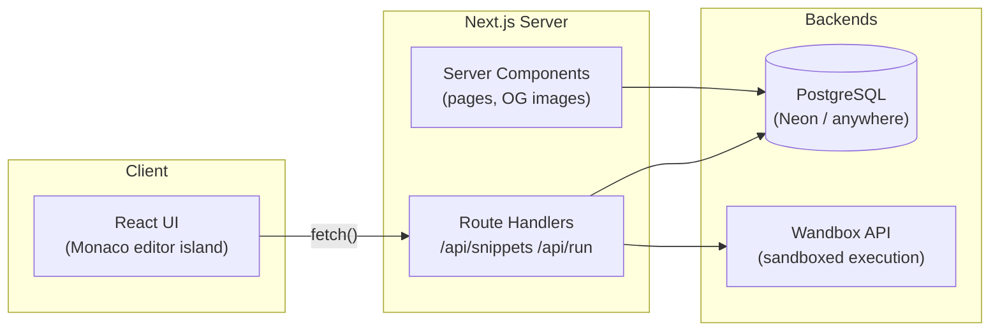

<div align="center">

# ⚡ Snippetly

**Create, run, and share code snippets with a single link.**

A fast, login-free code-snippet platform — write in a full Monaco editor, run it live,
and share it with a permanent URL. Built with Next.js App Router, TypeScript, and Tailwind CSS.

**🔴 Live on Vercel — https://snippetly-olive.vercel.app**

[](https://nextjs.org/)
[](https://www.typescriptlang.org/)
[](https://react.dev/)
[](https://tailwindcss.com/)
[](LICENSE)
[](https://vercel.com/)

</div>

## ✨ Why Snippetly?

Pasting code into chats is messy. Uploading a full repo for 20 lines is overkill.
Snippetly sits in between: **paste → run → share one link.** No signup walls, no ad-farm,
no iframe embeds — just a clean, fast tool for developers.

## 🧩 Features

- **Full Monaco editing** — the engine behind VS Code: syntax highlighting, autocomplete,
  ligatures, word wrap, and a custom dark theme.
- **Live code execution** — 17 languages executed in a sandboxed backend. Stdout, stderr,
  and exit codes render in a real console. Optional stdin support.
- **One-click sharing** — every snippet gets a short, memorable URL built from an
  unambiguous identifier alphabet (no `l`/`1`/`0`/`O` mixups).
- **Public or private** — private snippets are visible only in the browser that created
  them (owner key cookie), invisible to crawlers, and excluded from Explore.
- **Expiring snippets** — self-destruct timers of 1 h / 24 h / 7 d / 30 d, purged from the
  database automatically.
- **Remix** — fork any public snippet into your private workspace in one click.
- **Draft autosave** — your in-progress snippet survives accidental tab closes (localStorage).
- **Personal dashboard** — every snippet you've created from this browser, in one view.
- **Dynamic OG cards** — shared links unfurl into rich cards with the snippet's title and
  language (rendered with `next/og`).
- **Per-IP rate limiting** on the execution endpoint, payload size caps, and strict input
  validation.

## 🛠 Tech stack

| Layer | Choice |
| --- | --- |
| Framework | [Next.js 15](https://nextjs.org/) (App Router, Server Components) |
| Language | [TypeScript](https://www.typescriptlang.org/) (strict) |
| Styling | [Tailwind CSS 4](https://tailwindcss.com/) |
| Editor | [Monaco Editor](https://microsoft.github.io/monaco-editor/) via `@monaco-editor/react` |
| Code execution | [Wandbox](https://wandbox.org) public API (replaceable via `EXEC_API_URL`) |
| Database | PostgreSQL via [postgres.js](https://github.com/porsager/postgres) (any PG 14+ provider) |
| Hosting | [Vercel](https://vercel.com/) |

## 🏗 Architecture



**Storage modes** — the data layer is a small strategy interface:

| Mode | When | Behavior |
| --- | --- | --- |
| `PostgresStore` | `DATABASE_URL` is set | Full schema (auto-created), pooling, indexed queries, shared across serverless instances |
| `MemoryStore` | no `DATABASE_URL` (dev/demo) | Zero-config in-memory storage; resets on restart |

## 🚀 Getting started

```bash
git clone https://github.com/anjulsati/snippetly.git
cd snippetly
npm install
npm run dev
```

Open [http://localhost:3000](http://localhost:3000). That's it — with no database
configured the app runs in **demo mode** (in-memory storage).

For production:

```bash
npm run build
npm start
```

## 🔐 Environment variables

| Variable | Required | Description |
| --- | --- | --- |
| `DATABASE_URL` | recommended | PostgreSQL connection string. Free options: [Neon](https://neon.tech/) or [Supabase](https://supabase.com/). Without it, memory mode is used. |
| `NEXT_PUBLIC_SITE_URL` | optional | Public base URL for metadata (Vercel sets this automatically). |
| `EXEC_API_URL` | optional | Point at your own execution backend for private, unlimited runs. |

The table is created on first request (no migration step needed):

```sql
snippets (
  id TEXT PRIMARY KEY,          -- 10-char unambiguous id
  title, description, language, code,
  visibility TEXT,              -- 'public' | 'private'
  owner_key TEXT,               -- browser owner key (never exposed)
  views INTEGER,
  created_at / updated_at / expires_at TIMESTAMPTZ
)
```

## ☁️ Deploy

**One-time setup (~5 minutes):**

1. Create a free database at [neon.tech](https://neon.tech/) and copy the connection string.
2. Import the repo on [Vercel](https://vercel.com/new) and add `DATABASE_URL` as an
   environment variable.
3. Deploy. The schema is created automatically on the first request.

## 📁 Project structure

```
snippetly/
├── app/
│   ├── page.tsx                  # landing
│   ├── new/                      # create snippet
│   ├── explore/                  # recent public snippets
│   ├── mine/                     # personal dashboard
│   ├── s/[id]/                   # snippet view + edit + OG image
│   └── api/
│       ├── snippets/             # CRUD route handlers
│       ├── snippets/[id]/view/   # view counter
│       └── run/                  # execution proxy (+ rate limit)
├── components/                   # editor form, viewer, cards, layout
├── lib/
│   ├── store.ts / get-store.ts   # storage strategy interface
│   ├── memory-store.ts           # dev/demo store
│   ├── postgres-store.ts         # production store
│   ├── execute.ts                # code-execution client (Wandbox API)
│   ├── languages.ts              # 23 languages (17 runnable)
│   └── snippet.ts                # types + validation
└── styles/                       # tailwind theme
```

## 🛣 Roadmap

- [ ] Accounts (GitHub OAuth) for cross-device snippet sync
- [ ] Comments & reactions on public snippets
- [ ] Embeddable snippet widgets
- [ ] Multi-file snippets
- [ ] Snippet search & language filters
- [ ] Kotlin & Dart execution (requires a self-hosted `EXEC_API_URL` backend)

## 📄 License

Released under the [MIT License](LICENSE) © 2026 Anjul Sati.

## 🙏 Acknowledgments

Built with [Next.js](https://nextjs.org/), [Monaco Editor](https://microsoft.github.io/monaco-editor/),
and [Tailwind CSS](https://tailwindcss.com/). Code execution is powered by the
[free public Wandbox API](https://wandbox.org) — massive thanks to its maintainers.
Make sure to review its fair-use policy if you deploy publicly.
